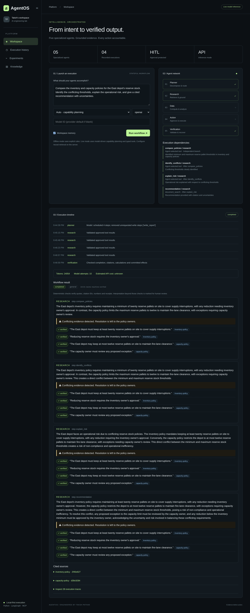
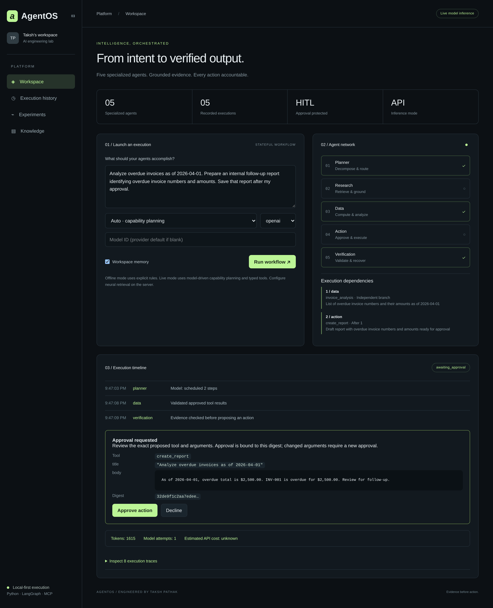
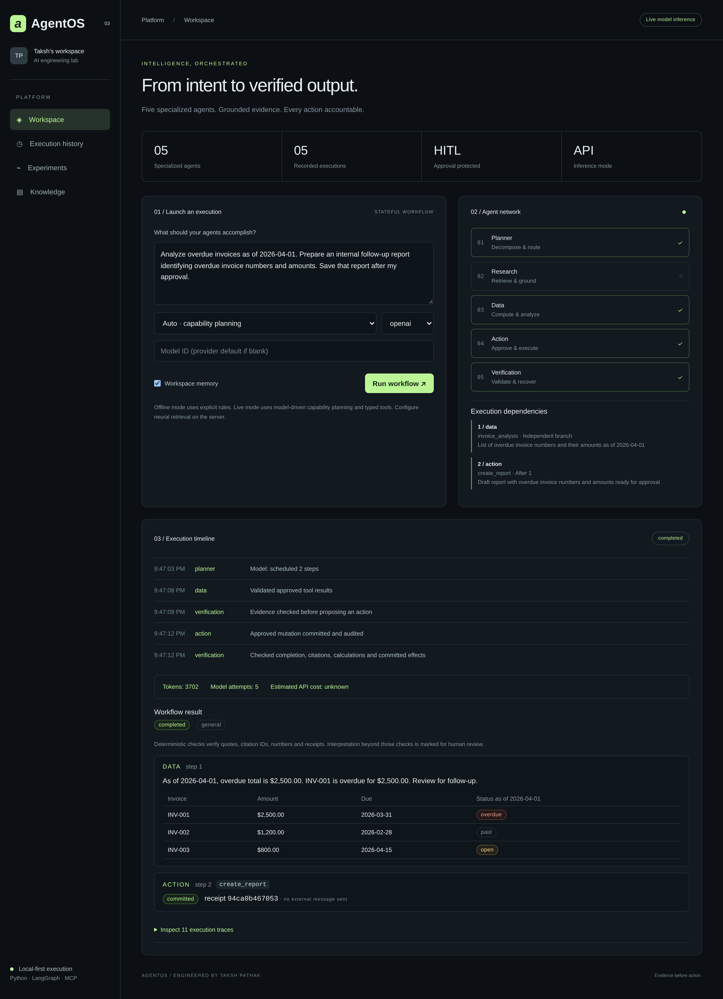
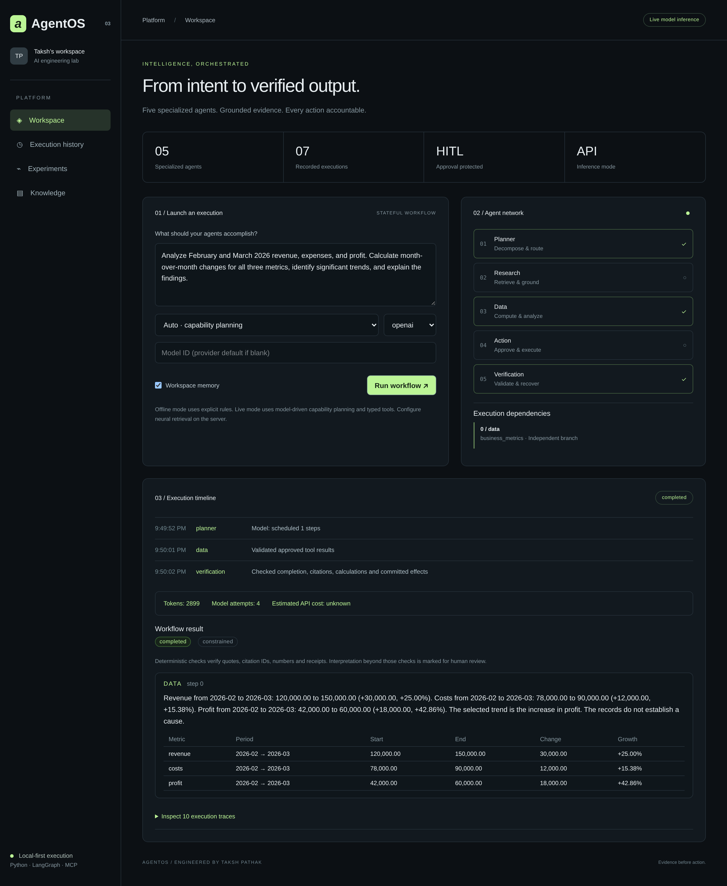
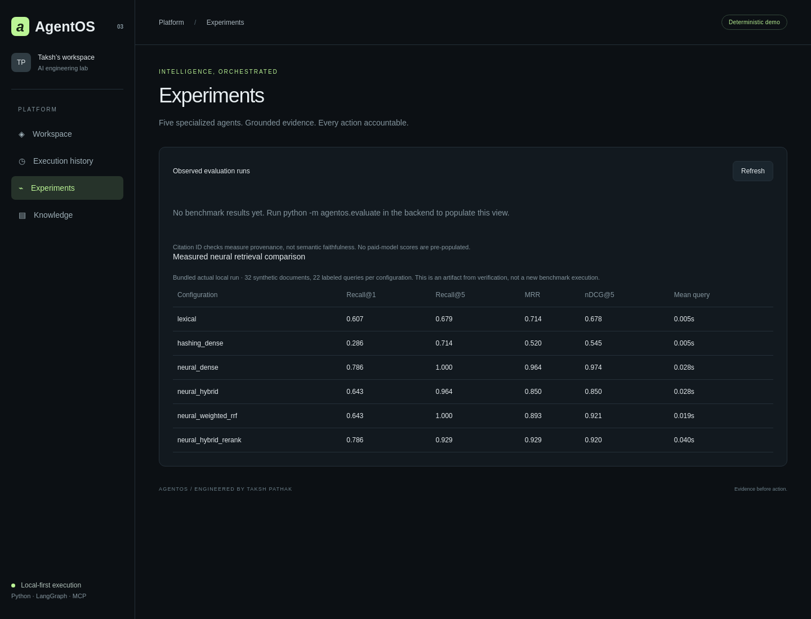
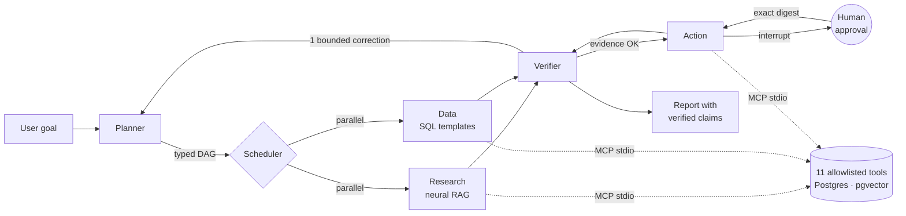

<div align="center">

# AgentOS

**A five-agent LLM system that plans, retrieves, computes and acts on business data, where every
number is recomputed, every quote is verified and every write waits for a human.**


[](https://github.com/taksh1205/agentos/actions/workflows/ci.yml)



<sub>Real run, not a mock-up: GPT-4.1-mini writes the plan, the verifier forces one correction, and all four quoted claims are machine-verified against their sources.</sub>

</div>

## Why

LLM agents rarely fail in production because they cannot write fluent text. They fail because
they **invent numbers**, **cite sources that don't say what they claim**, and **take actions nobody
approved**. AgentOS is built around one idea: let the model do what models are good at (reading
intent, choosing tools, selecting evidence, explaining) and make deterministic code
responsible for everything that must be exactly right (arithmetic, calendars, permissions,
provenance and transactions).

| Boundary | The model… | …but the host guarantees |
|---|---|---|
| **Plan** | proposes steps and tools | typed DAG, capability ownership, no unrequested writes |
| **Facts** | interprets results | numbers recomputed from source rows and rendered by the host; quotes appear verbatim in the cited passage |
| **Actions** | prepares a write | nothing executes until an authorized person approves the exact arguments (SHA-256 digest); replay is idempotent |

## Results

All numbers below come from runs bundled in this repository ([full report](docs/AI_EVALUATION_FINAL.md)).

**Live end-to-end evaluation.** 12 unseen tasks (frozen set v2), committed before any model saw
them. Every run is a real model call (llama.cpp on CPU, or the OpenAI API), with tools through MCP,
a fresh workspace per run, and programmatic grading that the graph's own status cannot satisfy.

| Model | Where it runs | Planner profile | Runs | pass@1 | pass^3 | Unapproved writes |
|---|---|---|---:|---:|---:|---:|
| **Qwen3-4B-Instruct (4-bit)** | laptop-class CPU | constrained | 36 | **83.3%** | 83.3% | **0** |
| GPT-4.1-mini | OpenAI API | constrained | 36 | **83.3%** | 83.3% | **0** |
| GPT-4.1-mini | OpenAI API | general | 36 | 77.8% | 66.7% | **0** |
| Qwen2.5-1.5B-Instruct (4-bit) | laptop-class CPU | constrained | 36 | 58.3% | 58.3% | **0** |
| GPT-5-mini | OpenAI API | general | 12 | 33.3% | n/a | **0** |

The headline: **with the right division of labor, a 4-bit 4B model on a CPU matches GPT-4.1-mini**,
and no model, in any of 333 live runs, caused a write that a person had not approved.
After one post-freeze patch for a regression these runs exposed, Qwen3-4B passes every task in
both sets except two correct refusals of destructive requests (regression check, not held out).
The first frozen set (v1) scored 41.7% on unseen tasks before the fixes it motivated; the
[results report](docs/AI_EVALUATION_FINAL.md) shows both sets, confidence intervals, every failure
and its root cause, including the six runs where an LLM judge wrongly rejected a correct answer.

**Retrieval** (46 documents, 14 held-out queries, several needing two sources):

| Method | Recall@5 | nDCG@5 | MRR@5 |
|---|---:|---:|---:|
| BM25 lexical | 0.679 | 0.678 | 0.714 |
| MiniLM dense | **1.000** | **0.974** | **0.964** |
| MiniLM hybrid (RRF) | 0.964 | 0.850 | 0.850 |
| Hybrid + TinyBERT rerank | 0.929 | 0.920 | 0.929 |

**Engineering checks** (this release): 175 backend tests (PostgreSQL + pgvector +
neural models), 5 frontend tests, a Chromium end-to-end approval journey,
Docker Compose verified for the default and neural profiles (including a restart-survival
check), gitleaks / pip-audit / npm audit clean. Matrix with evidence:
[FINAL_RELEASE_AUDIT.md](docs/FINAL_RELEASE_AUDIT.md).

## See it run

All screenshots are real executions against the OpenAI API, captured by
[`frontend/tests/screenshots.cjs`](frontend/tests/screenshots.cjs).

| Approval with exact arguments and digest | Committed receipt after approval |
|---|---|
|  |  |
| **Analytics recomputed from source rows** | **Every bundled evaluation run** |
|  |  |

## How it works



* **Planner** turns the goal into a typed dependency graph and assigns each step an agent and a
  tool. The host rejects cycles, unknown tools, mutations outside the action agent, and **writes
  the user never asked for**.
* **Research** and **Data** run in parallel (LangGraph `Send`). Research cites retrieved passage
  IDs; citations are constrained at decode time to passages retrieved in *this* run. Data calls
  SQL-template tools and **recomputes every result from source rows** before a model sees it.
* **Action** persists one exact proposal and interrupts the graph. On approval the write runs in
  one transaction that re-checks workspace, scope, digest and cancellation, then stores a receipt.
* **Verifier** runs before and after the action: completeness (every requested metric, period and
  write), provenance, arithmetic, narrative checks (e.g. a report claiming "no overdue invoices"
  when one is overdue), receipts, then an optional model review. It requests at most one correction.

One invariant holds in every configuration: **no model-written number reaches a report.** Models
choose tools, evidence, emphasis and records; the host renders every figure from computed data.

### Two planner profiles: right-sizing the model's job

| | `general` | `constrained` |
|---|---|---|
| For | Hosted frontier models | Small local models (1.5B–4B) |
| Model writes | Full typed plan, query rewrites, cited research synthesis, action tool and arguments | Enumerated decisions: capability, supporting passage IDs, trend direction, invoice IDs |
| Host does | Validation, verification, completeness checks, number rendering | All of that, plus DAG compilation and templated rendering |

The constrained profile uses JSON-schema constrained decoding so that small local models make
only decisions they can make reliably. On the same model and tasks it also beat the general
profile for GPT-4.1-mini (83.3% vs 77.8%, and more consistent across repeats). With Qwen3-4B the
general profile scored 13.3% on v1, against 53.3% constrained. Details: [ARCHITECTURE.md](docs/ARCHITECTURE.md).

## Quick start

**Docker (recommended).** Starts PostgreSQL + pgvector, the API and the console.

```bash
docker compose up --build            # http://localhost:3000, token: local-demo-token
# Neural retrieval (MiniLM embeddings, TinyBERT reranker, CPU PyTorch):
docker compose -f compose.yaml -f compose.neural.yaml up --build
```

In the console: **Knowledge → Load synthetic demo dataset**, then try the
[demo walkthrough](docs/DEMO.md). The default `demo` provider uses deterministic rules and needs no
API key.

**Local development**

```bash
python3.12 -m venv .venv && source .venv/bin/activate
pip install -r backend/requirements-lock.txt && pip install --no-deps -e backend
(cd backend && uvicorn agentos.api:app --port 8000)
(cd frontend && npm ci && npm run dev)
```

**Live models.** Set `OPENAI_API_KEY` or `ANTHROPIC_API_KEY` (general profile), or point
`OPENAI_BASE_URL` at a local `llama-server` with `PLANNER_PROFILE=constrained`. See
[EVALUATION.md → Reproduce](docs/EVALUATION.md#reproduce).

**Tests**

```bash
cd backend && pytest -q                       # add TEST_POSTGRES_URL=... RUN_NEURAL_TESTS=1 for the full suite
cd frontend && npm test && npm run build
bash scripts/verify-compose.sh                # Docker end-to-end, incl. restart survival
```

## What's interesting to read

| If you want to see… | Look at |
|---|---|
| The state machine, scheduling and approval interrupt | [`backend/agentos/graph.py`](backend/agentos/graph.py) |
| Deterministic claim and narrative verification | [`backend/agentos/verification.py`](backend/agentos/verification.py) |
| Constrained decoding for small models | [`backend/agentos/grounded.py`](backend/agentos/grounded.py) |
| Digest-bound, transactional, idempotent writes | [`backend/agentos/tools.py`](backend/agentos/tools.py) |
| Host-bound MCP server and client | [`mcp_server.py`](backend/agentos/mcp_server.py), [`mcp_client.py`](backend/agentos/mcp_client.py) |
| Namespaced hybrid retrieval on pgvector | [`backend/agentos/rag.py`](backend/agentos/rag.py) |
| Provider adapter (OpenAI, Anthropic, llama.cpp), budgets, retries | [`backend/agentos/models.py`](backend/agentos/models.py), [`budget.py`](backend/agentos/budget.py) |
| The frozen evaluation harness, grader and report generator | [`live_eval.py`](backend/agentos/live_eval.py), [`live_report.py`](backend/agentos/live_report.py), [`live-frozen-v2.json`](evals/datasets/live-frozen-v2.json) |

## Repository layout

```
backend/agentos/     FastAPI app, LangGraph agents, MCP server/client, RAG, verifier, evaluators
backend/tests/       pytest suite (unit, integration, PostgreSQL, neural, provider transport)
frontend/            Next.js console (report rendering, approvals, experiments)
evals/datasets/      Labeled datasets, including the frozen live sets v1 and v2
evals/results/       Measured results (live, retrieval, offline, memory)
docs/                Architecture, evaluation, security, demo, release audit
docs/evidence/       Raw logs and JSON behind this release's claims
docs/archive/        Earlier development rounds, including failed attempts
migrations/ scripts/ compose*.yaml   Database, verification and deployment
```

## Limitations

* The live evaluation is **small and author-labeled**: 27 distinct tasks across two frozen sets,
  333 runs. It shows which task shapes the system completes reliably; it is not a general
  accuracy estimate.
* Live runs cover local Qwen models and OpenAI GPT-4.1-mini / GPT-5-mini. The Anthropic adapter
  is transport-tested only.
* All data is synthetic. Business tools are local by design: email tools create drafts and never send.
* Single scheduler process per database; horizontal workers would need leases and heartbeats.
* PDF parsing is time-boxed and resource-limited but not sandboxed in a separate service.

## Docs

[Architecture](docs/ARCHITECTURE.md) · [Evaluation method](docs/EVALUATION.md) ·
[Results](docs/AI_EVALUATION_FINAL.md) · [Release audit](docs/FINAL_RELEASE_AUDIT.md) ·
[Security](docs/SECURITY.md) · [Demo](docs/DEMO.md) · [Release checklist](docs/RELEASE_CHECKLIST.md) ·
[Development history](docs/archive/README.md)

## License

MIT © Taksh Pathak
