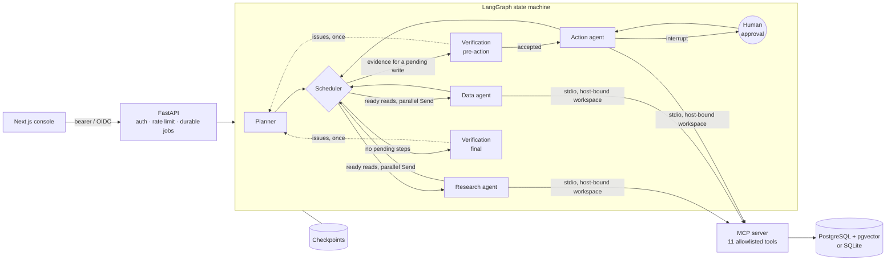
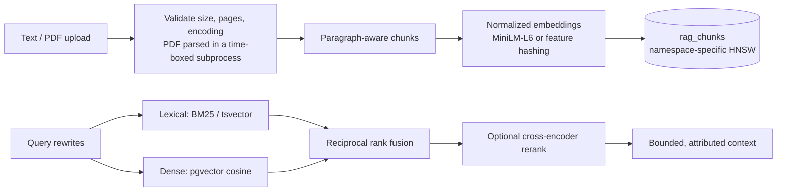

# Architecture

AgentOS turns a natural-language business request into a **checked plan**, gathers evidence
from documents and databases through **allowlisted tools**, pauses for a **human approval**
before any write, and **verifies** every number, quote and receipt before it reports success.

The core idea is three trust boundaries:

| Boundary | Who decides | Enforced by |
|---|---|---|
| What to do | The model proposes a plan | Pydantic schemas, capability ownership, DAG validation, write-intent gate |
| What is true | Tools compute and retrieve | SQL templates, source-row recomputation, quote and citation checks |
| What may change | A person approves | Exact-argument digest, checkpoint interrupt, transactional receipt, replay idempotency |

## System overview



* **Planner**: turns the goal into typed steps (`agent`, `tool`, `instruction`, `dependencies`).
  The host validates the DAG (no cycles, no unknown dependencies), checks capability ownership
  (only the action agent can hold a mutating tool), and removes write steps the request never asked
  for (see *write-intent gate*).
* **Scheduler**: dispatches every ready read step in one LangGraph superstep using `Send`, so
  research and analytics run in parallel. Results merge by stable step ID, so a replayed
  step replaces its earlier result instead of duplicating it.
* **Research agent**: rewrites the query, runs neural or hybrid retrieval through MCP, bounds the
  context, and returns cited claims. Citation IDs are constrained to passages actually retrieved
  in this execution.
* **Data agent**: discovers dataset schemas, extracts a typed `AnalyticsIntent` (metric, period,
  cutoff), calls SQL-template tools, then **recomputes the result from source rows** and rejects
  any mismatch before a model interprets it.
* **Action agent**: prepares exactly one typed local operation, persists the proposal (tool +
  canonical arguments + SHA-256 digest), and interrupts the graph. Nothing is written before an
  authorized approval.
* **Verification agent**: runs twice. *Pre-action* checks the evidence a write depends on.
  *Final* checks step completion, citation membership, recomputed numbers, committed receipts,
  then an optional model review. It requests at most one bounded correction.

## Planner profiles: who owns which decision

The same graph supports two profiles (`PLANNER_PROFILE`), recorded in every plan trace and report.

| | `general` (default) | `constrained` |
|---|---|---|
| Intended for | Capable hosted models (OpenAI, Anthropic) | Small local models (Qwen 1.5B–4B on llama.cpp) |
| Plan | Model writes the full typed DAG | Model picks a capability (or several); host compiles the DAG |
| Research | Model writes cited claims | Model selects supporting passage IDs from an enum, plus a recommendation and uncertainty label |
| Analytics | Model writes typed numeric/trend claims | Model selects the trend direction; host renders the computed values |
| Invoices | Model writes a summary | Model selects invoice numbers; host checks the set exactly against the cutoff-filtered rows |
| Action args | Model writes arguments | Report body assembled from verified dependency findings |

The constrained profile is a deliberate engineering choice, not a shortcut. It uses JSON-schema
**constrained decoding** so that a 1.5B-parameter model only makes decisions it can make
reliably, and the host does arithmetic, calendars and formatting. The cost is expressiveness:
prose is templated, and a request outside the supported shapes falls back to a generic summary.
The evaluation reports both profiles separately.

## Verification layers

No single check is trusted. Each layer catches a different failure class:

1. **Schema**: every model output is a strict Pydantic model (`extra="forbid"`). Invalid output
   is a `ProviderError`, never a partial result.
2. **Capability**: unknown tools, mutations outside the action agent, cycles and missing
   dependencies are rejected before execution.
3. **Write-intent gate**: an auto-planned write survives only if the request contains a write
   verb (save, store, file, create, export, draft, email, notify, update, …). Scopes say what a
   principal *may* do. This says what *this request* asked to do.
4. **Calendar binding**: explicit, unambiguous months in the request (`February and March 2026`,
   `April through June 2026`) bind analytics periods deterministically. Ambiguous or
   non-contiguous phrases are left to the model.
5. **Provenance**: cited IDs must belong to this execution's retrieved passages; quotes must
   appear verbatim in the cited passage.
6. **Arithmetic**: tool results are recomputed from source rows; numeric and trend claims must
   bind to a metric, period and basis that the data supports (MoM requires adjacent months, YoY
   requires a 12-month baseline).
7. **Narrative**: high-value misleading patterns are caught even without structured claims:
   unknown invoice IDs, wrong invoice amounts, wrong overdue status, blanket "no invoices are
   overdue" claims that contradict the cutoff-filtered rows, causal language not supported by
   data.
8. **Effects**: a reported write must have a committed receipt whose stored payload equals the
   approved arguments.
9. **Model review** (general profile): a fallible second opinion. It can reject but never
   overrides a failed deterministic check.

Each research/data finding carries `grounding.fully_checked` (every structured claim passed a
deterministic check) and `grounding.requires_review` (some content goes beyond what code can
verify). The console renders these as **verified** / **review** / **rejected** badges.

## Approval protocol

```mermaid
sequenceDiagram
    participant A as Action agent
    participant DB as Database
    participant H as Approver (admin)
    participant T as MCP tool
    A->>DB: INSERT approval (tool, canonical args, digest) status=pending
    A-->>H: interrupt(proposal id, tool, args, digest)
    H->>DB: POST /runs/{id}/approval {approve, proposal_id}
    DB-->>A: resume with decision
    A->>T: call(tool, args, approval_id)
    T->>DB: BEGIN; check workspace, status, digest(args), run not cancelled
    T->>DB: claim approval -> executing; perform local write
    T->>DB: INSERT effect receipt; status=executed; COMMIT
    T-->>A: receipt
    Note over T,DB: Replaying the same approval returns the stored receipt.<br/>Changed arguments fail the digest check.
```

The proposal is persisted **before** the interrupt, and a replayed node reuses it, so the
arguments a person reviewed are the only arguments that can execute. Every tool is local: email
tools create drafts and set `external_message_sent: false`.

## Durability and limits

* Jobs are written in the same transaction as the run status and dispatched by a single
  scheduler (file lock or PostgreSQL advisory lock). Queued or interrupted jobs resume after a
  restart. Graph state is checkpointed with `AsyncSqliteSaver` or `AsyncPostgresSaver`.
* Bounded: plan length (12), recursion depth, per-request and per-run timeouts, context size,
  output tokens, retries (3, transient errors only), corrections (1), and a database-backed token
  and cost ledger shared by parallel branches. Unknown provider usage keeps its reservation. A
  dollar limit without configured prices fails closed.
* Every model, tool and plan decision is traced with schema name, prompt version, latency, token
  usage and errors. Raw prompts and full source bodies are excluded. OpenTelemetry export is
  optional.

## Retrieval



Each embedding space is identified by a namespace hash of backend, model, resolved revision,
dimension and normalization, so vectors from different models can never be compared. Changing
the encoder requires an explicit `POST /documents/reindex`. Ingestion is idempotent by content
hash. The measured comparison (dense MiniLM best on this corpus) is in
[AI_EVALUATION_FINAL.md](AI_EVALUATION_FINAL.md#retrieval).

## Memory

Short-term conversation turns live in graph state. Long-term semantic memory stores normalized
embeddings with workspace, provenance, TTL and exact-content deduplication. Memory is disabled in
every evaluation so cases cannot leak answers to each other.

## Design decisions and trade-offs

| Decision | Why | Cost |
|---|---|---|
| LangGraph state machine, not a free-form agent loop | Checkpoints, interrupts and parallel `Send` are first-class; every transition is inspectable | More code than a ReAct loop |
| Host computes, model interprets | LLMs are unreliable at arithmetic and calendars; SQL is not | The model cannot invent new metrics |
| Constrained profile for small models | Lets a 1.5B local model complete real workflows reliably | Templated prose; narrower request shapes |
| Approval bound to an argument digest | Reviewed arguments are the only executable arguments | A changed proposal needs a new approval |
| MCP over stdio with host-bound identity | Tools cannot choose their own workspace or scopes | Subprocess startup per call (~1–2 s) |
| Single scheduler with durable jobs | Correct restart semantics without a distributed queue | No horizontal workers yet |
| Dense retrieval as the neural default | Best nDCG@5 on the labeled corpus; fusion added weak lexical matches | Dense alone can miss exact-term queries on other corpora |
| Deterministic verifiers plus a fallible model review | Code checks are reproducible; the model catches semantic issues code cannot | Some paraphrases stay `needs_review` instead of verified |

## Known limits

* One scheduler process per database; horizontal workers need leases and heartbeats.
* PDF parsing runs in a time-boxed subprocess under the application's user, not a sandbox.
* No PostgreSQL row-level security; tenant isolation is enforced in application queries and tests.
* Deleting a document does not cascade into historical reports, memories or traces.
* All business tools are local. There are no external connectors by design.
