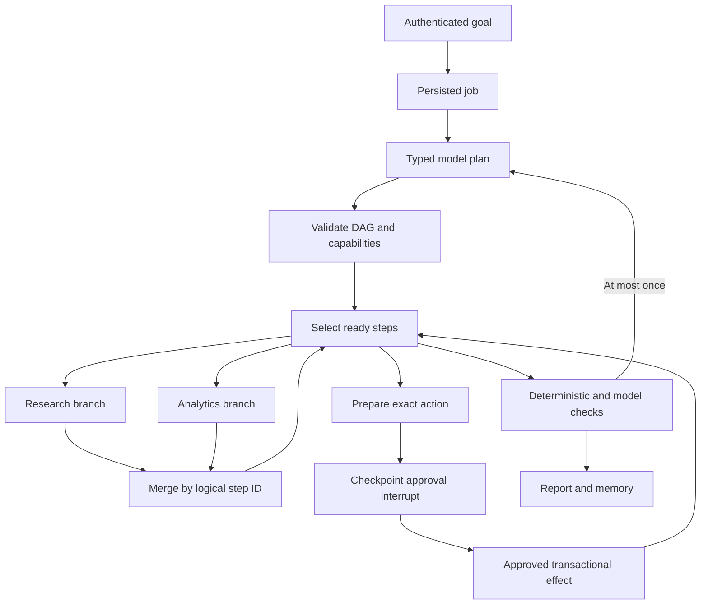
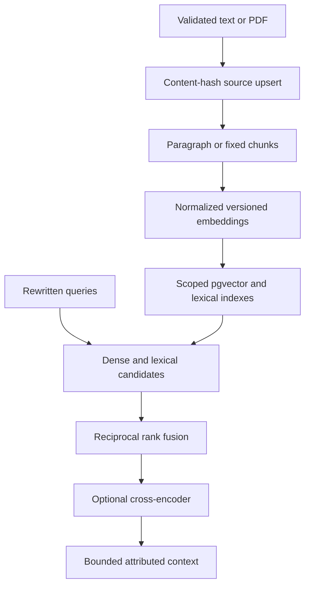
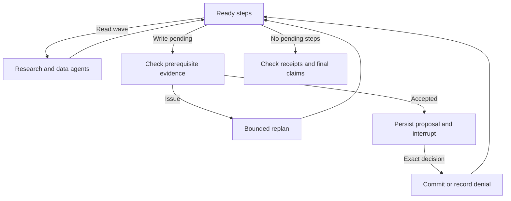

# Architecture and design decisions

AgentOS V2 retains the original FastAPI, LangGraph, Next.js, SQLAlchemy, MCP, and evaluation architecture. `models.py` now uses maintained official provider SDKs directly; the unused provider-specific LangChain adapters were removed. LangGraph still supplies the graph engine and checkpoint contracts. Optional Sentence Transformers runs actual PyTorch/Transformers inference for embeddings and reranking; no custom training or GPU optimization is claimed.

Ready research/data steps use LangGraph Send in one superstep. Their result and event channels merge deterministically by stable keys; re-executing a step replaces its prior result. Failed plans receive new logical step IDs on correction, while action identity is independently bound to workspace/run/canonical arguments. This avoids duplicate mutations even if the planner repeats a previously completed action.

Plans carry agent, instruction, dependencies, tool/arguments when known, completion criteria, and approval requirement. The server validates capabilities and forces all mutations through the action agent. Live planning ignores the legacy three-template workflow selection; natural-language goals choose tools. The offline planner remains an explicit rule baseline for CI.

Research rewrites multiple complementary queries, merges source hits, bounds context with intact source IDs, and requests a typed synthesis with claims, citations, contradictions, and insufficiency. Known-ID validation is deterministic; semantic support requires the fallible model review or external adjudication. Source text never grants tool permissions.

Analytics discovers datasets, extracts a structured intent, invokes approved tools, independently recomputes totals/trends from raw records, and asks a model to interpret those results. Numeric statements are checked against computed values before being accepted. This check can reject some legitimate reformulations and is not general mathematical proof. SQL identifiers and operators come only from server templates or validated literal enums.

Action preparation may call a model, but the exact arguments are persisted before interrupt. On resume the persisted proposal is reused, preventing changed arguments after review. The tool transaction checks workspace, scope, approval digest, cancellation state, existing receipt, and current record before committing an effect. CSV, report, follow-up, email draft, inventory update, and notification are local operations only.

## Retrieval storage

`rag_sources` stores original extracted text; `rag_chunks` stores chunk vectors and metadata. A namespace fingerprints backend, model, resolved revision, dimension, and normalization version. PostgreSQL uses unbounded vector storage and namespace-specific dimension-cast HNSW indexes. The original V1 384-dimensional document index remains for compatibility but is not the V2 retrieval index. PostgreSQL fetches candidate IDs only; SQLite scans a tenant's chunks for a portable small-data path. Filtering never accepts a caller-supplied tenant override.

Source replacement and all its chunk writes use one transaction. Reindex changes document vectors to the configured namespace; queries reject mixed namespaces. Model changes require an explicit reindex. Workspace-wide reindex is currently document-transactional, not one global transaction; queries can temporarily reject the mixed workspace until it finishes. Original V1 chunks can be imported explicitly; their overlapping text may contain repeated passages.

## Memory and persistence

Short-term conversation is a bounded list in checkpoint state. Semantic memory has normalized vectors, namespace, expiry, exact-content deduplication, run/source provenance, and bounded summaries. Expired memory is removed lazily per tenant. Reindexing documents does not automatically reindex memory; mismatched memory namespaces are ignored. Document deletion does not yet cascade through historical memories or reports, so retention/deletion is not a comprehensive erasure guarantee.

Application persistence is SQLite or PostgreSQL. Graph checkpoints use AsyncSqliteSaver locally or AsyncPostgresSaver when CHECKPOINT_DATABASE_URL is set. Persisted jobs recover on restart. A single-worker guard uses a file lock or PostgreSQL advisory lock. This intentionally avoids a half-implemented Redis queue. Horizontal workers require a different lease/heartbeat and ownership design; the existing lease column is informational, not a distributed claim of correctness.

## Limits and observability

Plan length, graph recursion, overall execution time, provider request time, context size, output tokens, retries, and correction count are bounded. Parallel calls share atomic token/cost reservations in `budgets`. Unknown billed usage stays reserved; limits can stop requests but cannot undo charges for an in-flight request. Prices are operator supplied and must be refreshed; no current provider prices were guessed.

The trace store records plan decisions, validated tool metadata, model/schema/prompt-version identifiers, retrieved IDs, rerank scores, timings, errors, and usage. Full source bodies and raw prompts are excluded from model/retrieval traces, but task state and plan instructions can contain user data. Optional OpenTelemetry emits metadata spans. These spans are event-level instrumentation, not a fully correlated distributed trace across every subprocess.

### V3 control flow

A validated plan owns each step's tool, arguments, predecessors and optional measurable checks. A ready wave dispatches independent reads. A dependent step receives a bounded packet containing only successful direct and transitive predecessors. The verifier runs before an action and again after its receipt. Recovery feeds concrete issues back to the planner once. A changed evidence fingerprint requires another check. The pending proposal survives graph replay. Job insertion shares a database transaction with the API status transition.

